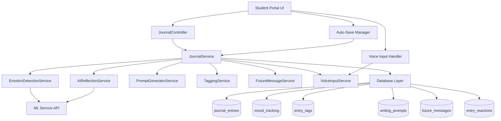
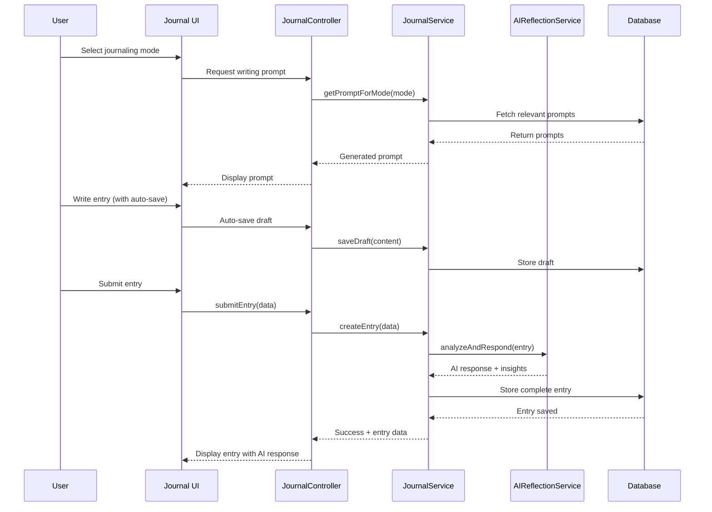

# Design Document: Advanced Emotional Journal

## Overview

The Advanced Emotional Journal transforms the existing basic journal into a modern, emotionally intelligent system with guided prompts, advanced mood tracking with intensity levels and sub-emotions, smart tagging, AI-powered reflection tools, and interactive features. The system provides structured entries with title, mood, content, and AI responses, along with specialized journaling modes (quick vent, deep reflection, gratitude), voice input support, auto-save functionality, and a "Message to Future Me" feature with scheduled delivery. The design emphasizes clean, professional UI with mood-based visuals and smooth animations for an immersive emotional support experience.

## Architecture



## Main Workflow



## Components and Interfaces

### Component 1: JournalController

**Purpose**: Handles HTTP requests for journal operations and coordinates between UI and services

**Interface**:
```php
class JournalController extends Controller
{
    public function index(): View;
    public function create(Request $request): View;
    public function store(StoreJournalEntryRequest $request): JsonResponse;
    public function show(int $id): View;
    public function update(int $id, UpdateJournalEntryRequest $request): JsonResponse;
    public function destroy(int $id): JsonResponse;
    public function getPrompt(string $mode): JsonResponse;
    public function saveDraft(Request $request): JsonResponse;
    public function addReaction(int $entryId, string $reactionType): JsonResponse;
    public function addReflection(int $entryId, Request $request): JsonResponse;
}
```

**Responsibilities**:
- Route handling for all journal operations
- Request validation and sanitization
- Response formatting
- Session management for auto-save


### Component 2: JournalService

**Purpose**: Core business logic for journal entry management

**Interface**:
```php
class JournalService
{
    public function createEntry(array $data): JournalEntry;
    public function updateEntry(int $id, array $data): JournalEntry;
    public function deleteEntry(int $id): bool;
    public function getEntries(int $userId, array $filters = []): Collection;
    public function saveDraft(int $userId, array $data): Draft;
    public function getDraft(int $userId): ?Draft;
    public function addTags(int $entryId, array $tags): void;
    public function addReaction(int $entryId, int $userId, string $type): Reaction;
    public function addReflectionUpdate(int $entryId, string $content): Reflection;
}
```

**Responsibilities**:
- Entry CRUD operations
- Draft management
- Tag association
- Reaction tracking
- Reflection updates


### Component 3: AIReflectionService

**Purpose**: Provides AI-powered reflection, reframing, and perspective tools

**Interface**:
```php
class AIReflectionService
{
    public function generateReflection(string $content, string $mood): string;
    public function reframeThought(string $thought): array;
    public function provideAdvice(string $content, array $context): string;
    public function generatePerspective(string $content, string $perspectiveType): string;
    public function analyzeEntry(string $content): array;
}
```

**Responsibilities**:
- Generate AI reflections
- Thought reframing
- Contextual advice
- Multiple perspective generation (friend, future self, mentor)
- Entry analysis for insights


### Component 4: PromptGeneratorService

**Purpose**: Generates contextual writing prompts based on mode and user history

**Interface**:
```php
class PromptGeneratorService
{
    public function getPromptForMode(string $mode, ?int $userId = null): string;
    public function shufflePrompt(string $currentPrompt): string;
    public function getGuidedPrompts(string $category): array;
    public function generatePersonalizedPrompt(int $userId): string;
}
```

**Responsibilities**:
- Mode-specific prompt generation
- Prompt shuffling (Mood Shuffle feature)
- Guided writing prompts
- Personalized prompts based on history


### Component 5: MoodTrackingService

**Purpose**: Advanced mood tracking with intensity levels and sub-emotions

**Interface**:
```php
class MoodTrackingService
{
    public function recordMood(int $userId, string $primaryMood, int $intensity, array $subEmotions): MoodRecord;
    public function getMoodHistory(int $userId, int $days = 30): Collection;
    public function analyzeMoodPatterns(int $userId): array;
    public function getMoodInsights(int $userId): array;
}
```

**Responsibilities**:
- Record mood with intensity (1-10 scale)
- Track sub-emotions
- Mood pattern analysis
- Generate mood insights


### Component 6: FutureMessageService

**Purpose**: Handles "Message to Future Me" feature with scheduled delivery

**Interface**:
```php
class FutureMessageService
{
    public function createFutureMessage(int $userId, string $content, Carbon $deliveryDate): FutureMessage;
    public function scheduledDelivery(): void;
    public function deliverMessage(int $messageId): bool;
    public function getPendingMessages(int $userId): Collection;
    public function cancelMessage(int $messageId): bool;
}
```

**Responsibilities**:
- Create future-dated messages
- Schedule delivery via queue
- Deliver messages on scheduled date
- Manage pending messages


### Component 7: VoiceInputService

**Purpose**: Converts voice input to text for hands-free journaling

**Interface**:
```php
class VoiceInputService
{
    public function transcribeAudio(UploadedFile $audioFile): string;
    public function processVoiceStream(string $audioData): string;
    public function getSupportedLanguages(): array;
}
```

**Responsibilities**:
- Audio file transcription
- Real-time voice stream processing
- Multi-language support


## Data Models

### Model 1: JournalEntry

```php
class JournalEntry extends Model
{
    protected $fillable = [
        'user_id',
        'title',
        'content',
        'mode',
        'primary_mood',
        'mood_intensity',
        'sub_emotions',
        'ai_response',
        'ai_reflection',
        'ai_reframing',
        'ai_advice',
        'prompt_used',
        'word_count',
        'is_draft',
        'published_at'
    ];
    
    protected $casts = [
        'sub_emotions' => 'array',
        'mood_intensity' => 'integer',
        'is_draft' => 'boolean',
        'published_at' => 'datetime'
    ];
}
```

**Validation Rules**:
- title: optional, max 200 characters
- content: required, min 10 characters, max 10000 characters
- mode: required, enum ['quick_vent', 'deep_reflection', 'gratitude']
- primary_mood: required, string
- mood_intensity: required, integer 1-10
- sub_emotions: optional, array of strings


### Model 2: MoodRecord

```php
class MoodRecord extends Model
{
    protected $fillable = [
        'user_id',
        'journal_entry_id',
        'primary_mood',
        'intensity',
        'sub_emotions',
        'recorded_at'
    ];
    
    protected $casts = [
        'sub_emotions' => 'array',
        'intensity' => 'integer',
        'recorded_at' => 'datetime'
    ];
}
```

**Validation Rules**:
- primary_mood: required, string, max 50 characters
- intensity: required, integer, min 1, max 10
- sub_emotions: optional, array, max 5 items
- recorded_at: required, datetime


### Model 3: EntryTag

```php
class EntryTag extends Model
{
    protected $fillable = [
        'journal_entry_id',
        'tag_name',
        'tag_color'
    ];
}
```

**Validation Rules**:
- tag_name: required, string, max 30 characters, alphanumeric with spaces
- tag_color: optional, hex color code

### Model 4: FutureMessage

```php
class FutureMessage extends Model
{
    protected $fillable = [
        'user_id',
        'content',
        'delivery_date',
        'delivered_at',
        'is_delivered',
        'notification_sent'
    ];
    
    protected $casts = [
        'delivery_date' => 'datetime',
        'delivered_at' => 'datetime',
        'is_delivered' => 'boolean',
        'notification_sent' => 'boolean'
    ];
}
```

**Validation Rules**:
- content: required, string, min 10 characters, max 5000 characters
- delivery_date: required, datetime, must be future date


### Model 5: EntryReaction

```php
class EntryReaction extends Model
{
    protected $fillable = [
        'journal_entry_id',
        'user_id',
        'reaction_type'
    ];
}
```

**Validation Rules**:
- reaction_type: required, enum ['like', 'helpful', 'insightful']

### Model 6: EntryReflection

```php
class EntryReflection extends Model
{
    protected $fillable = [
        'journal_entry_id',
        'user_id',
        'reflection_content',
        'reflected_at'
    ];
    
    protected $casts = [
        'reflected_at' => 'datetime'
    ];
}
```

**Validation Rules**:
- reflection_content: required, string, min 10 characters, max 2000 characters


## Algorithmic Pseudocode

### Main Entry Creation Algorithm

```php
function createJournalEntry(array $data): JournalEntry
{
    // Preconditions:
    // - $data contains valid user_id, content, mode, primary_mood, mood_intensity
    // - User is authenticated
    // - Content length is within limits (10-10000 characters)
    
    // Step 1: Validate and sanitize input
    $validated = validateEntryData($data);
    
    // Step 2: Generate title if not provided
    if (empty($validated['title'])) {
        $validated['title'] = generateTitleFromContent($validated['content']);
    }
    
    // Step 3: Calculate word count
    $validated['word_count'] = str_word_count($validated['content']);
    
    // Step 4: Create mood record
    $moodRecord = MoodRecord::create([
        'user_id' => $validated['user_id'],
        'primary_mood' => $validated['primary_mood'],
        'intensity' => $validated['mood_intensity'],
        'sub_emotions' => $validated['sub_emotions'] ?? [],
        'recorded_at' => now()
    ]);
    
    // Step 5: Generate AI responses
    $aiReflection = AIReflectionService::generateReflection(
        $validated['content'],
        $validated['primary_mood']
    );
    
    $aiReframing = AIReflectionService::reframeThought($validated['content']);
    $aiAdvice = AIReflectionService::provideAdvice($validated['content'], [
        'mood' => $validated['primary_mood'],
        'intensity' => $validated['mood_intensity']
    ]);
    
    // Step 6: Create journal entry
    $entry = JournalEntry::create([
        ...$validated,
        'ai_reflection' => $aiReflection,
        'ai_reframing' => json_encode($aiReframing),
        'ai_advice' => $aiAdvice,
        'is_draft' => false,
        'published_at' => now()
    ]);
    
    // Step 7: Associate mood record with entry
    $moodRecord->update(['journal_entry_id' => $entry->id]);
    
    // Step 8: Process and add tags
    if (!empty($validated['tags'])) {
        foreach ($validated['tags'] as $tag) {
            EntryTag::create([
                'journal_entry_id' => $entry->id,
                'tag_name' => $tag,
                'tag_color' => generateTagColor($tag)
            ]);
        }
    }
    
    // Step 9: Clear any existing draft
    Draft::where('user_id', $validated['user_id'])->delete();
    
    // Postconditions:
    // - Entry is created with all AI responses
    // - Mood record is linked to entry
    // - Tags are associated
    // - Draft is cleared
    // - Returns valid JournalEntry object
    
    return $entry;
}
```


### Auto-Save Algorithm

```php
function autoSaveDraft(int $userId, array $data): Draft
{
    // Preconditions:
    // - User is authenticated
    // - $data contains at least content field
    
    // Step 1: Find or create draft
    $draft = Draft::firstOrNew(['user_id' => $userId]);
    
    // Step 2: Update draft data
    $draft->fill([
        'content' => $data['content'] ?? $draft->content,
        'title' => $data['title'] ?? $draft->title,
        'mode' => $data['mode'] ?? $draft->mode,
        'primary_mood' => $data['primary_mood'] ?? $draft->primary_mood,
        'mood_intensity' => $data['mood_intensity'] ?? $draft->mood_intensity,
        'sub_emotions' => $data['sub_emotions'] ?? $draft->sub_emotions,
        'tags' => $data['tags'] ?? $draft->tags,
        'last_saved_at' => now()
    ]);
    
    // Step 3: Save draft
    $draft->save();
    
    // Postconditions:
    // - Draft is saved with timestamp
    // - Returns Draft object
    
    return $draft;
}
```


### Mood Shuffle Algorithm

```php
function shufflePrompt(string $mode, ?string $currentPrompt = null): string
{
    // Preconditions:
    // - $mode is valid journaling mode
    
    // Step 1: Get all prompts for mode
    $prompts = WritingPrompt::where('mode', $mode)
        ->where('is_active', true)
        ->get();
    
    // Step 2: Filter out current prompt if provided
    if ($currentPrompt) {
        $prompts = $prompts->filter(function($prompt) use ($currentPrompt) {
            return $prompt->text !== $currentPrompt;
        });
    }
    
    // Step 3: Return random prompt
    $selectedPrompt = $prompts->random();
    
    // Postconditions:
    // - Returns different prompt than current
    // - Prompt matches requested mode
    
    return $selectedPrompt->text;
}
```


### Future Message Delivery Algorithm

```php
function deliverScheduledMessages(): void
{
    // Preconditions:
    // - Called by scheduled task (daily cron job)
    
    // Step 1: Get all messages due for delivery
    $dueMessages = FutureMessage::where('is_delivered', false)
        ->where('delivery_date', '<=', now())
        ->get();
    
    // Step 2: Process each message
    foreach ($dueMessages as $message) {
        // Loop Invariant: All previously processed messages are marked as delivered
        
        try {
            // Step 2.1: Create notification
            Notification::create([
                'user_id' => $message->user_id,
                'type' => 'future_message',
                'title' => 'Message from Your Past Self',
                'content' => $message->content,
                'data' => json_encode(['message_id' => $message->id])
            ]);
            
            // Step 2.2: Mark as delivered
            $message->update([
                'is_delivered' => true,
                'delivered_at' => now(),
                'notification_sent' => true
            ]);
            
            // Step 2.3: Send email notification
            Mail::to($message->user->email)->send(
                new FutureMessageDelivered($message)
            );
            
        } catch (Exception $e) {
            Log::error('Failed to deliver future message', [
                'message_id' => $message->id,
                'error' => $e->getMessage()
            ]);
        }
    }
    
    // Postconditions:
    // - All due messages are marked as delivered
    // - Notifications created for users
    // - Emails sent
}
```


## Key Functions with Formal Specifications

### Function 1: generateReflection()

```php
function generateReflection(string $content, string $mood): string
```

**Preconditions:**
- `$content` is non-empty string with minimum 10 characters
- `$mood` is valid mood identifier
- ML service is available and responsive

**Postconditions:**
- Returns non-empty string containing AI-generated reflection
- Reflection is contextually relevant to content and mood
- Response length is between 50-500 characters
- No sensitive data is exposed in reflection

**Loop Invariants:** N/A

### Function 2: reframeThought()

```php
function reframeThought(string $thought): array
```

**Preconditions:**
- `$thought` is non-empty string
- Thought contains identifiable cognitive pattern

**Postconditions:**
- Returns array with keys: 'original', 'reframed', 'technique'
- 'reframed' provides alternative perspective
- 'technique' identifies cognitive reframing method used
- Array structure is valid and complete

**Loop Invariants:** N/A


### Function 3: generatePerspective()

```php
function generatePerspective(string $content, string $perspectiveType): string
```

**Preconditions:**
- `$content` is non-empty string
- `$perspectiveType` is one of: 'friend', 'future_self', 'mentor'
- ML service is available

**Postconditions:**
- Returns perspective-specific response
- Response tone matches requested perspective type
- Response length is between 100-600 characters
- Response is supportive and constructive

**Loop Invariants:** N/A

### Function 4: transcribeAudio()

```php
function transcribeAudio(UploadedFile $audioFile): string
```

**Preconditions:**
- `$audioFile` is valid audio file (mp3, wav, m4a, webm)
- File size is under 10MB
- Audio duration is under 5 minutes
- Speech-to-text service is available

**Postconditions:**
- Returns transcribed text string
- Text is properly punctuated
- Returns empty string if no speech detected
- Throws exception if transcription fails

**Loop Invariants:** N/A


### Function 5: analyzeMoodPatterns()

```php
function analyzeMoodPatterns(int $userId): array
```

**Preconditions:**
- `$userId` exists in database
- User has at least 7 mood records
- Mood records span at least 7 days

**Postconditions:**
- Returns array with keys: 'trends', 'patterns', 'insights', 'recommendations'
- 'trends' contains mood frequency data
- 'patterns' identifies recurring mood cycles
- 'insights' provides human-readable analysis
- 'recommendations' suggests actionable steps
- All array values are non-null

**Loop Invariants:**
- For mood aggregation loop: All processed records maintain data integrity
- Running totals remain accurate throughout iteration

## Example Usage

### Example 1: Creating a Journal Entry

```php
// User submits journal entry
$data = [
    'user_id' => auth()->id(),
    'title' => 'Feeling Overwhelmed Today',
    'content' => 'I have so much work to do and I feel like I can\'t keep up...',
    'mode' => 'quick_vent',
    'primary_mood' => 'anxious',
    'mood_intensity' => 7,
    'sub_emotions' => ['stressed', 'worried', 'tired'],
    'tags' => ['work', 'stress', 'deadlines']
];

$entry = $journalService->createEntry($data);

// Entry is created with AI responses
echo $entry->ai_reflection; // "It sounds like you're experiencing..."
echo $entry->ai_advice; // "Consider breaking down your tasks..."
```


### Example 2: Auto-Save Functionality

```php
// JavaScript triggers auto-save every 30 seconds
fetch('/api/journal/auto-save', {
    method: 'POST',
    headers: { 'Content-Type': 'application/json' },
    body: JSON.stringify({
        content: editorContent,
        title: titleInput,
        mode: selectedMode,
        primary_mood: selectedMood,
        mood_intensity: intensitySlider.value
    })
})
.then(response => response.json())
.then(data => {
    showAutoSaveIndicator('Saved at ' + data.last_saved_at);
});
```

### Example 3: Mood Shuffle

```php
// User clicks "Shuffle Prompt" button
$currentPrompt = "What made you smile today?";
$newPrompt = $promptGenerator->shufflePrompt('gratitude', $currentPrompt);

// Returns different prompt
echo $newPrompt; // "What are three things you're grateful for right now?"
```

### Example 4: Future Message

```php
// User creates message to future self
$futureMessage = $futureMessageService->createFutureMessage(
    userId: auth()->id(),
    content: "Remember: You are stronger than you think. Keep going!",
    deliveryDate: now()->addMonths(6)
);

// Message will be delivered in 6 months via scheduled job
```


### Example 5: Voice Input

```php
// User records voice entry
$audioFile = $request->file('audio');
$transcription = $voiceInputService->transcribeAudio($audioFile);

// Use transcription as entry content
$entry = $journalService->createEntry([
    'user_id' => auth()->id(),
    'content' => $transcription,
    'mode' => 'quick_vent',
    'primary_mood' => 'neutral',
    'mood_intensity' => 5
]);
```

### Example 6: AI Perspectives

```php
// Generate multiple perspectives for an entry
$content = "I failed my exam and feel like a failure.";

$friendPerspective = $aiReflectionService->generatePerspective(
    $content, 
    'friend'
);
// "Hey, one exam doesn't define you. Everyone has setbacks..."

$futureSelfPerspective = $aiReflectionService->generatePerspective(
    $content, 
    'future_self'
);
// "Looking back, this was just a small bump in the road..."

$mentorPerspective = $aiReflectionService->generatePerspective(
    $content, 
    'mentor'
);
// "Failure is feedback. What can you learn from this experience?"
```


## Correctness Properties

### Universal Quantification Statements

1. **Entry Integrity**: ∀ entry ∈ JournalEntries: entry.user_id ≠ null ∧ entry.content.length ≥ 10 ∧ entry.content.length ≤ 10000

2. **Mood Intensity Range**: ∀ mood ∈ MoodRecords: mood.intensity ≥ 1 ∧ mood.intensity ≤ 10

3. **Draft Uniqueness**: ∀ user ∈ Users: |{draft ∈ Drafts | draft.user_id = user.id}| ≤ 1

4. **Future Message Validity**: ∀ msg ∈ FutureMessages: msg.delivery_date > msg.created_at ∧ (msg.is_delivered ⟹ msg.delivered_at ≠ null)

5. **Tag Association**: ∀ tag ∈ EntryTags: ∃ entry ∈ JournalEntries: tag.journal_entry_id = entry.id

6. **Reaction Uniqueness**: ∀ user, entry, type: |{reaction ∈ EntryReactions | reaction.user_id = user ∧ reaction.journal_entry_id = entry ∧ reaction.reaction_type = type}| ≤ 1

7. **AI Response Completeness**: ∀ entry ∈ JournalEntries: entry.is_draft = false ⟹ (entry.ai_reflection ≠ null ∧ entry.ai_advice ≠ null)

8. **Mode Validity**: ∀ entry ∈ JournalEntries: entry.mode ∈ {'quick_vent', 'deep_reflection', 'gratitude'}

9. **Sub-Emotion Limit**: ∀ mood ∈ MoodRecords: |mood.sub_emotions| ≤ 5

10. **Auto-Save Timestamp**: ∀ draft ∈ Drafts: draft.last_saved_at ≤ now()


## Error Handling

### Error Scenario 1: ML Service Unavailable

**Condition**: AI reflection service fails to respond or returns error
**Response**: 
- Log error with context
- Return graceful fallback message: "We're processing your entry. AI insights will be available shortly."
- Queue entry for background AI processing
- Display entry without AI responses initially
**Recovery**: 
- Background job retries AI generation
- Updates entry when successful
- Sends notification to user when AI responses are ready

### Error Scenario 2: Voice Transcription Failure

**Condition**: Audio file cannot be transcribed (poor quality, unsupported format, service error)
**Response**:
- Return user-friendly error message
- Suggest alternative: "We couldn't transcribe your audio. Please try recording again or type your entry."
- Log error details for debugging
**Recovery**:
- Allow user to retry with same or new audio file
- Provide option to switch to text input

### Error Scenario 3: Auto-Save Conflict

**Condition**: Multiple browser tabs attempt to auto-save simultaneously
**Response**:
- Use last-write-wins strategy with timestamp comparison
- Detect conflict and notify user: "Your entry is open in another tab"
- Provide option to sync or keep current version
**Recovery**:
- Merge changes if possible
- Allow user to choose which version to keep


### Error Scenario 4: Future Message Delivery Failure

**Condition**: Email notification fails or user account is deleted before delivery
**Response**:
- Mark message as delivery attempted
- Log failure reason
- Retry email delivery up to 3 times with exponential backoff
- If user deleted: mark message as undeliverable
**Recovery**:
- Store message in notification center as fallback
- User can view in-app even if email fails

### Error Scenario 5: Invalid Mood Data

**Condition**: Client sends mood intensity outside 1-10 range or invalid mood type
**Response**:
- Return 422 validation error with specific field errors
- Message: "Mood intensity must be between 1 and 10"
- Preserve other valid form data
**Recovery**:
- Client displays validation errors
- User corrects invalid fields
- Form resubmits with valid data

### Error Scenario 6: Database Connection Loss

**Condition**: Database becomes unavailable during entry creation
**Response**:
- Catch database exception
- Store entry data in Redis cache temporarily
- Return user message: "We're experiencing technical difficulties. Your entry is saved and will be processed shortly."
**Recovery**:
- Background job monitors database availability
- Processes cached entries when database recovers
- Notifies user when entry is successfully saved


## Testing Strategy

### Unit Testing Approach

**Coverage Goals**: Minimum 80% code coverage for all service classes

**Key Test Cases**:

1. **JournalService Tests**
   - Test entry creation with valid data
   - Test entry creation with missing required fields
   - Test draft save and retrieval
   - Test tag association
   - Test reaction addition and uniqueness constraint
   - Test reflection update functionality

2. **MoodTrackingService Tests**
   - Test mood recording with valid intensity (1-10)
   - Test mood recording with invalid intensity (boundary testing)
   - Test sub-emotion limit enforcement (max 5)
   - Test mood pattern analysis with sufficient data
   - Test mood pattern analysis with insufficient data

3. **AIReflectionService Tests**
   - Mock ML service responses
   - Test reflection generation with various moods
   - Test thought reframing with different cognitive patterns
   - Test perspective generation for all types (friend, future_self, mentor)
   - Test error handling when ML service is unavailable

4. **PromptGeneratorService Tests**
   - Test prompt retrieval for each mode
   - Test shuffle functionality returns different prompt
   - Test personalized prompt generation
   - Test handling of empty prompt database


5. **FutureMessageService Tests**
   - Test message creation with future date
   - Test rejection of past dates
   - Test scheduled delivery logic
   - Test delivery notification creation
   - Test handling of deleted user accounts

6. **VoiceInputService Tests**
   - Mock speech-to-text API
   - Test transcription with valid audio files
   - Test rejection of invalid file formats
   - Test file size limit enforcement
   - Test handling of empty/silent audio

### Property-Based Testing Approach

**Property Test Library**: PHPUnit with Eris (property-based testing library for PHP)

**Properties to Test**:

1. **Entry Content Length Property**
   - Property: For any valid entry, content length is always between 10 and 10000 characters
   - Generator: Random strings of varying lengths
   - Assertion: Entries with content < 10 or > 10000 are rejected

2. **Mood Intensity Boundary Property**
   - Property: Mood intensity is always within [1, 10] range
   - Generator: Random integers including edge cases
   - Assertion: System accepts 1-10, rejects all others

3. **Draft Uniqueness Property**
   - Property: Each user has at most one draft at any time
   - Generator: Multiple draft save operations for same user
   - Assertion: Only one draft exists per user after operations


4. **Future Message Date Property**
   - Property: Future message delivery date is always after creation date
   - Generator: Random date pairs
   - Assertion: System rejects messages with delivery_date <= created_at

5. **Tag Association Property**
   - Property: All tags are associated with existing entries
   - Generator: Random tag operations
   - Assertion: No orphaned tags exist (referential integrity)

6. **Auto-Save Idempotency Property**
   - Property: Multiple auto-saves with same data produce same result
   - Generator: Repeated save operations with identical data
   - Assertion: Draft content and timestamp are consistent

### Integration Testing Approach

**Integration Test Scenarios**:

1. **End-to-End Entry Creation Flow**
   - Test complete flow from UI to database
   - Verify ML service integration
   - Confirm mood record creation
   - Validate tag association
   - Check AI response generation

2. **Auto-Save and Recovery Flow**
   - Simulate user typing with periodic auto-saves
   - Simulate browser crash/refresh
   - Verify draft recovery on page reload
   - Confirm no data loss

3. **Future Message Delivery Flow**
   - Create future message
   - Mock time advancement to delivery date
   - Trigger scheduled job
   - Verify notification creation
   - Confirm email sending


4. **Voice Input Integration**
   - Upload audio file
   - Verify transcription service call
   - Confirm text extraction
   - Validate entry creation with transcribed content

5. **Multi-Tab Auto-Save Conflict**
   - Open journal in two browser tabs
   - Make different edits in each tab
   - Trigger auto-save from both
   - Verify conflict detection and resolution

6. **ML Service Fallback**
   - Simulate ML service downtime
   - Create journal entry
   - Verify graceful degradation
   - Confirm background job queuing
   - Test recovery when service returns

## Performance Considerations

**Response Time Requirements**:
- Entry creation: < 2 seconds (including AI generation)
- Auto-save: < 500ms
- Prompt shuffle: < 200ms
- Voice transcription: < 5 seconds for 1-minute audio
- Mood pattern analysis: < 1 second for 90 days of data

**Optimization Strategies**:
1. **Caching**: Cache writing prompts in Redis (TTL: 1 hour)
2. **Async Processing**: Queue AI response generation for background processing if ML service is slow
3. **Database Indexing**: Index user_id, created_at, mode, primary_mood columns
4. **Lazy Loading**: Load AI perspectives on-demand rather than pre-generating all three
5. **Pagination**: Limit entry list to 20 per page with infinite scroll
6. **Asset Optimization**: Compress mood-based gradient images, lazy-load animations


**Scalability Considerations**:
- Partition journal_entries table by user_id for horizontal scaling
- Use read replicas for analytics queries (mood patterns, insights)
- Implement rate limiting: 100 entries per user per day
- Queue future message delivery checks (avoid scanning entire table)
- Archive entries older than 2 years to separate cold storage

## Security Considerations

**Data Privacy**:
- Encrypt journal entry content at rest using AES-256
- Encrypt AI responses and reflections
- Implement field-level encryption for sensitive mood data
- Ensure entries are only accessible by owner (strict authorization checks)

**Access Control**:
- Verify user authentication on all journal endpoints
- Implement CSRF protection on all POST/PUT/DELETE requests
- Use Laravel's authorization policies for entry access
- Prevent counselors from accessing journal entries without explicit user consent

**Input Validation**:
- Sanitize all user input to prevent XSS attacks
- Validate file uploads (type, size, content) for voice input
- Implement rate limiting on API endpoints (10 requests/minute for entry creation)
- Validate mood intensity range server-side (don't trust client)

**Audit Logging**:
- Log all entry creation, updates, and deletions with timestamps
- Log AI service interactions for debugging and compliance
- Track future message delivery attempts
- Monitor for suspicious patterns (mass deletion, rapid creation)


**Data Retention**:
- Allow users to permanently delete entries (GDPR compliance)
- Implement soft deletes with 30-day recovery window
- Anonymize deleted user data after 90 days
- Provide data export functionality (JSON format)

## Dependencies

**Backend Dependencies**:
- Laravel 10.x (PHP framework)
- MySQL 8.0+ (primary database)
- Redis 6.0+ (caching and queue management)
- Laravel Horizon (queue monitoring)
- Laravel Sanctum (API authentication)
- Guzzle HTTP (ML service communication)
- Carbon (date/time manipulation)
- Laravel Excel (data export)

**ML/AI Dependencies**:
- Existing ML Service API (emotion detection, response generation)
- OpenAI API or similar (for advanced AI features like perspective generation)
- Speech-to-text service (Google Cloud Speech-to-Text, AWS Transcribe, or Azure Speech)

**Frontend Dependencies**:
- Alpine.js or Vue.js (reactive UI components)
- Tailwind CSS (styling framework)
- Chart.js (mood visualization)
- Quill.js or TinyMCE (rich text editor)
- Recorder.js (audio recording for voice input)
- Day.js (date formatting)
- Animate.css (smooth animations)

**Infrastructure Dependencies**:
- Laravel Queue Worker (background job processing)
- Laravel Scheduler (cron jobs for future message delivery)
- Email service (SendGrid, Mailgun, or AWS SES)
- File storage (local or S3 for audio files)
- SSL certificate (HTTPS for security)
